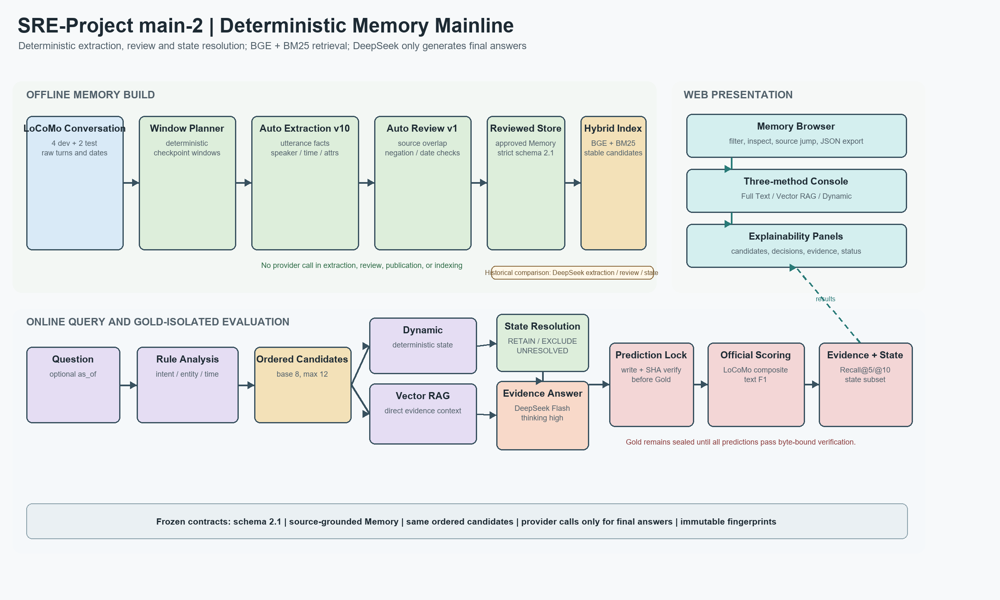

# 智能体动态记忆管理系统：main-2 主线最终报告

## 软件需求工程课程最终报告

| 项目 | 内容 |
| --- | --- |
| 团队 | 收手吧阿组 |
| 项目仓库 | `ACN67/SRE-Project` |
| 汇报主线 | `main-2` |
| 数据快照 SHA256 | `79fa87e90f04081343b8c8debecb80a9a6842b76a7aa537dc9fdf651ea698ff4` |
| 最终报告日期 | 2026-11-06 |
| 当前结论 | `MAIN2_AUTOMATION_COMPLETE` / `DEVELOPMENT_FREEZE_COMPLETE` / `FORMAL_TEST_COMPLETE` |

---

## 摘要

本项目面向 LoCoMo 长期多会话对话，构建可追溯、可更新、可检索和可评测的智能体记忆系统。历史 `main` 路线曾在事实抽取、事实审核和动态状态解析三个关键环节调用 DeepSeek。

本次汇报以 `main-2` 为主线。`main-2` 将上述三个本来依赖大模型的部分替换为确定性算法：

1. `auto-utterance-v10-state-attributes` 从原始轮次和句子生成结构化事实；
2. `auto-extractive-v1` 依据原句、说话者、时间和否定语气执行保守审核；
3. `deterministic-state-v5-state-chain` 依据实体、属性、时间和状态变化执行关系判断与有效记忆选择。

最终自然语言答案仍由 DeepSeek Flash High 生成。历史 DeepSeek 抽取、审核和状态路线保留为对照基线，不再作为 `main-2` 的生产主线。

四个开发对话共 757 道问题，两段独立测试对话共 400 道问题，均已完成 Full Text、Vector RAG 和 Dynamic 三路预测。全部预测在读取 Gold 前落盘并完成 SHA256 校验。开发集 Vector RAG 综合分由 `0.601955` 提升到 `0.627715`，Dynamic 由 `0.580745` 提升到 `0.614078`，Evidence Recall@10 由 `0.539006` 提升到 `0.647230`。正式测试 Vector RAG 综合分由 `0.602550` 提升到 `0.639702`，Dynamic 由 `0.582716` 提升到 `0.601676`，Evidence Recall@10 由 `0.531095` 提升到 `0.672944`。

---

## 1. 报告口径：main-2 是什么

`main` 代表前期已经完成 A/B/C/D/E 集成、真实模型抽取、语义审核、动态状态解析、三路评测和 Web 验收的基线。

`main-2` 是本报告的主线，它在不改变公共 Schema、来源追溯、发布门禁、候选集共用和 Gold 隔离机制的前提下，替换以下模型决策点：

| 流程环节 | 历史路线 | main-2 主线 |
| --- | --- | --- |
| 事实抽取 | DeepSeek 窗口抽取 | 本地规则与句式结构化抽取 |
| 事实审核 | DeepSeek 语义审核 | 原文回查、否定与时间一致性审核 |
| Dynamic 状态解析 | DeepSeek 关系与决策 | 确定性状态链和时态规则 |
| 索引 | 本地 BGE 向量 | BGE 向量 + BM25 混合重排 |
| 最终自然语言答案 | DeepSeek | DeepSeek，保持不变 |
| Gold 访问 | 预测先锁定，后评分 | 保持不变 |

因此，“自动化替代”指用确定性程序替代抽取、审核和状态选择中的模型调用；最终答案生成仍属于大模型职责。自动阶段产生的远端 HTTP 调用数为 0。

---

## 2. 课程要求与完成情况

| 课程要求 | main-2 实现 | 状态 |
| --- | --- | --- |
| 4 段开发对话 | `conv-26/30/41/42` 完成自动构建、索引、757 题三路预测和评分 | 完成 |
| 2 段独立测试对话 | `conv-49/50` 完成自动构建、索引、400 题三路预测和评分 | 完成 |
| 结构化 Memory | 保存内容、实体、属性、时间、事实性质、极性和来源 | 完成 |
| 来源追溯 | 每条 Memory 绑定 `sample_id/session_id/dia_id/speaker/recorded_at` | 完成 |
| 查询分析与检索 | 规则意图、实体与时间解析，基础 Top-8、最多 12 个有序候选 | 完成 |
| 状态维护 | RETAIN、EXCLUDE、UNRESOLVED 与 UPDATE/SUPERSEDE/CONFLICT | 完成 |
| 三路对照 | Full Text、Vector RAG、Dynamic | 完成 |
| QA 指标 | LoCoMo 官方类别规则和文本 Token F1 | 完成 |
| Evidence Recall | Evidence-turn Recall@5 / Recall@10 | 完成 |
| 动态状态指标 | 团队标注重映射子集；测试集无官方状态 Gold，记 N/A | 完成并说明限制 |
| Web | Memory 浏览、来源回查、三路问答、状态解释和 JSON 下载 | 完成 |
| 版本控制 | 分支、提交、PR、Merge Commit 和过程材料 | 完成 |

---

## 3. 系统架构与数据流



图 1 由 `tools/build_main2_architecture.py` 生成，展示离线构建、在线查询、Web 展示和 Gold 隔离评测之间的关系。

### 3.1 离线构建

```text
LoCoMo conversation
  -> 数据快照、拆分和 SourceRepository
  -> 固定窗口与不可变 checkpoint
  -> 自动事实抽取
  -> 自动原文回查审核
  -> 严格发布 Reviewed Memory
  -> BGE + BM25 混合索引
```

离线构建不读取问答 Gold。每条事实必须能回查到原始轮次；审核失败或不确定的事实不发布。发布产物记录抽取器、审核器、窗口、来源、Memory 集合和索引指纹。

### 3.2 在线查询

```text
问题 + 可选 as_of
  -> 规则查询分析
  -> 本地索引加载与身份校验
  -> BGE + BM25 有序候选集
       -> Vector RAG：直接使用候选证据回答
       -> Dynamic：状态关系、逐 Memory 决策、有效集合、回答
  -> 统一 QueryResponse
```

Vector RAG 和 Dynamic 使用同一题目的相同查询分析、相同候选 ID 与顺序。Dynamic 的差异仅是增加状态解析与有效记忆过滤。

### 3.3 Gold 隔离评测

1. 三种方法分别产生完整预测。
2. 预测文件原子写入。
3. 校验样本、题目 ID、方法、顺序、快照和文件 SHA256。
4. 所有预测通过验证后，评分器才读取答案与证据 Gold。
5. 计算 LoCoMo 综合分、文本 F1、Evidence Recall 和状态指标。

---

## 4. main-2 核心实现

### 4.1 自动事实抽取

`src/dynamic_memory/memory/auto_extraction.py` 以轮次和句子为单位生成候选事实，确定性地记录：

- 原始内容；
- 说话者；
- 实体与属性；
- 事实类型；
- 肯定或否定极性；
- 记录时间与可解析的事件时间；
- 原始来源轮次。

计划、假设、不确定语气、否定、明确日期、相对日期和图片 caption 分别处理。无法可靠判定的字段保留为空，不把猜测写成确定事实。

### 4.2 自动审核与严格发布

`src/dynamic_memory/memory/auto_review.py` 重新读取事实引用的原始轮次并检查：

- 是否只引用一个来源；
- 事实词项能否在不相关的上下文中错误拼接；
- 说话者和来源是否一致；
- 时间表达是否与原句一致；
- 否定、未来计划和不确定性是否保持一致。

审核器为 `auto-extractive-v1`。审核策略源码指纹绑定发布权限，修改批准文件不能把 `unclear` 事实变为已批准事实。

### 4.3 确定性状态解析

`src/dynamic_memory/reasoning/auto_resolver.py` 根据问题实体与属性提示筛选候选，并完成：

- 同主体状态链排序；
- 记录时间与事件时间比较；
- UPDATE、SUPERSEDE、CONFLICT 和 NO_RELATION；
- 每条候选的 RETAIN、EXCLUDE 或 UNRESOLVED；
- 有效记忆集合构造。

无法安全消解的冲突保持 UNRESOLVED，不强行生成唯一状态。

### 4.4 混合检索与候选一致性

`c-local-index-v7-state-hybrid` 在本地 BGE 向量结果上加入确定性 BM25 重排。索引投影保留：

- 原始内容；
- 说话者；
- 已审核实体与属性；
- 原始时间表达；
- 来源轮次。

候选构造优先覆盖不同证据轮次，并允许在已审核 Memory 中扩展有限的相邻轮次。Vector RAG 和 Dynamic 共享同一 CandidateSet，避免把检索差异误解释成状态解析效果。

### 4.5 最终答案生成

最终答案使用：

| 配置 | 值 |
| --- | --- |
| 模型 | `deepseek-flash` |
| Thinking | enabled |
| Reasoning effort | high |
| `max_tokens` | 请求中省略 |
| Retry | 0 |
| 单样本并发 | 1 |
| 自动抽取/审核/状态 API | 0 |

---

## 5. A/B/C/D/E 模块映射

| 模块 | 主要职责 | main-2 变化 |
| --- | --- | --- |
| A | 公共 DTO、运行调度、答案生成、评分和冻结 | 增加自动阶段零调用预算、预测隔离和统一聚合 |
| B | 数据加载、Memory 构建、审核、发布 | 新增自动抽取和自动审核 |
| C | 查询分析、索引、检索和候选构造 | 新增结构化投影、BM25 混合和轮次多样性 |
| D | 状态关系、有效记忆和证据问答 | 新增默认确定性状态解析，保留显式 LLM 对照入口 |
| E | Web、Memory 浏览、问答和下载 | 复用统一生产服务，支持开发和测试样本 |

---

## 6. Memory 构建数据

| 样本 | 分组 | 窗口 | 批准事实 | 排除事实 | 发布 Memory | Build ID |
| --- | --- | ---: | ---: | ---: | ---: | --- |
| `conv-26` | dev | 83 | 1439 | 30 | 1097 | `build_73aff780add44a249e6540056fc226ef` |
| `conv-30` | dev | 63 | 1077 | 50 | 868 | `build_153674f1be2344e582e6461f543c9105` |
| `conv-41` | dev | 123 | 2099 | 65 | 1646 | `build_36032426363c4611a5bb2240b77cf4c3` |
| `conv-42` | dev | 108 | 1717 | 57 | 1366 | `build_246e382efc99413c9415d6a86a4c2227` |
| `conv-49` | test | 89 | 1534 | 32 | 1224 | `build_8487316f64ed43e491039ed05068e7ab` |
| `conv-50` | test | 113 | 1936 | 134 | 1516 | `build_8c28c377dfec473093440a4b0a972b5e` |
| **合计** | 6 样本 | **579** | **9802** | **368** | **7717** | 6 个完整构建 |

审核通过率为 `9802 / 10170 = 96.38%`。未通过事实保持不发布，系统不把审核失败自动改写为通过。

---

## 7. 实验设计

### 7.1 数据划分

| 分组 | 对话 | 问题数 |
| --- | --- | ---: |
| 开发集 | `conv-26/30/41/42` | 757 |
| 独立测试 | `conv-49/50` | 400 |

### 7.2 对照方法

- **Full Text**：使用完整原始对话作为强上下文基线。
- **Vector RAG**：使用检索候选，不做状态关系过滤。
- **Dynamic**：使用相同候选，再执行状态关系和有效集合判断。

### 7.3 指标

- LoCoMo 官方类别综合分；
- 普通文本 Token F1；
- Evidence-turn Recall@5；
- Evidence-turn Recall@10；
- 状态更新、逐 Memory 决策、有效集合 Exact Match/F1；
- 调用数、Token、时延和估算费用。

---

## 8. 实验结果

### 8.1 开发集逐样本

| 样本 | 题数 | Full Text | Vector RAG | Dynamic |
| --- | ---: | ---: | ---: | ---: |
| `conv-26` | 199 | 0.770153 | 0.636888 | 0.645352 |
| `conv-30` | 105 | 0.732310 | 0.664487 | 0.644212 |
| `conv-41` | 193 | 0.806798 | 0.664979 | 0.662542 |
| `conv-42` | 260 | 0.671991 | 0.578182 | 0.541998 |
| **全部** | **757** | **0.740532** | **0.627715** | **0.614078** |

### 8.2 开发集历史路线与 main-2 对比

| 指标 | 历史路线 | main-2 | 变化 |
| --- | ---: | ---: | ---: |
| Full Text | 0.733758 | 0.740532 | +0.006774 |
| Vector RAG | 0.601955 | 0.627715 | +0.025760 |
| Dynamic | 0.580745 | 0.614078 | +0.033333 |
| Evidence Recall@5 | 0.489441 | 0.560606 | +0.071165 |
| Evidence Recall@10 | 0.539006 | 0.647230 | +0.108224 |

Evidence Recall 的 752 道题进入分母；其余 5 道题官方证据为空或无法唯一定位来源，不进入 Recall 分母，但仍参加 QA 评分。

### 8.3 开发集分类别结果

| 方法 | C1 多跳/列表 | C2 时间 | C3 开放推断 | C4 单跳 | C5 对抗 |
| --- | ---: | ---: | ---: | ---: | ---: |
| Full Text | 0.609875 | 0.731571 | 0.415596 | 0.753966 | 0.867052 |
| Vector RAG | 0.318672 | 0.662816 | 0.340596 | 0.597242 | 0.907514 |
| Dynamic | 0.342495 | 0.642373 | 0.328673 | 0.568535 | 0.901734 |

自动状态路径在 C1 上优于 Vector RAG，但 C2/C4 的保守排除仍带来一定召回损失。

### 8.4 独立测试结果

| 样本 | 题数 | 方法 | LoCoMo 综合分 | Text F1 | Recall@5 | Recall@10 |
| --- | ---: | --- | ---: | ---: | ---: | ---: |
| `conv-49` | 196 | Full Text | 0.710829 | 0.539993 | N/A | N/A |
| `conv-49` | 196 | Vector RAG | 0.632844 | 0.454570 | 0.612468 | 0.660915 |
| `conv-49` | 196 | Dynamic | 0.586349 | 0.405715 | 0.612468 | 0.660915 |
| `conv-50` | 204 | Full Text | 0.712079 | 0.522255 | N/A | N/A |
| `conv-50` | 204 | Vector RAG | 0.646290 | 0.448826 | 0.592869 | 0.684494 |
| `conv-50` | 204 | Dynamic | 0.616402 | 0.428377 | 0.592869 | 0.684494 |
| **合计** | **400** | **Full Text** | **0.711466** | **0.530947** | N/A | N/A |
| **合计** | **400** | **Vector RAG** | **0.639702** | **0.451641** | **0.602469** | **0.672944** |
| **合计** | **400** | **Dynamic** | **0.601676** | **0.417273** | **0.602469** | **0.672944** |

正式测试与历史路线相比：

| 指标 | 历史路线 | main-2 | 变化 |
| --- | ---: | ---: | ---: |
| Full Text | 0.718232 | 0.711466 | -0.006766 |
| Vector RAG | 0.602550 | 0.639702 | +0.037152 |
| Dynamic | 0.582716 | 0.601676 | +0.018960 |
| Evidence Recall@5 | 0.459859 | 0.602469 | +0.142610 |
| Evidence Recall@10 | 0.531095 | 0.672944 | +0.141849 |

394 道题进入 Evidence Recall 分母；其余 6 道题不进入，但仍参加 QA。

### 8.5 正式测试分类别结果

| 方法 | C1 | C2 | C3 | C4 | C5 |
| --- | ---: | ---: | ---: | ---: | ---: |
| Full Text | 0.511115 | 0.761565 | 0.539329 | 0.731445 | 0.837209 |
| Vector RAG | 0.353064 | 0.577643 | 0.649378 | 0.662406 | 0.872093 |
| Dynamic | 0.331740 | 0.573694 | 0.455289 | 0.608652 | 0.860465 |

### 8.6 运行状态与费用

| 分组 | Answered | No evidence | Time uncertain | Conflict | Error | Calls |
| --- | ---: | ---: | ---: | ---: | ---: | ---: |
| 开发 Full Text | 757 | 0 | 0 | 0 | 0 | 752 |
| 开发 Vector RAG | 757 | 0 | 0 | 0 | 0 | 757 |
| 开发 Dynamic | 724 | 33 | 0 | 0 | 0 | 729 |
| 测试 Full Text | 400 | 0 | 0 | 0 | 0 | 396 |
| 测试 Vector RAG | 400 | 0 | 0 | 0 | 0 | 400 |
| 测试 Dynamic | 366 | 34 | 0 | 0 | 0 | 370 |

开发阶段的 `calls` 字段是 HTTP 调用账本记录数，可能少于 3×题数，因为少数早期状态响应或预算路径没有发起新的 provider 请求；三路最终 `error=0`。

全部 QA 总计：

| 项目 | 结果 |
| --- | ---: |
| HTTP 调用 | 3404 |
| Prompt tokens | 50,463,972 |
| Cache hit tokens | 45,682,217 |
| Cache miss tokens | 4,781,755 |
| Completion tokens | 999,983 |
| Reasoning tokens | 978,083 |
| 估算费用 | USD 2.9085994 / CNY 20.9419 |
| 开发集平均延迟 | 2.3459 秒 |
| 测试平均延迟 | 2.3337 秒 |

---

## 9. 动态状态评测

课程正式测试不提供状态 Gold，因此测试集动态状态准确率记 `N/A`。开发集使用团队复核标注，并将旧 Memory 标注映射到 main-2 Memory。

| 指标 | 结果 |
| --- | ---: |
| 状态题 | 11 |
| 原始 Gold item | 112 |
| 成功映射 item | 107 |
| 逐 Memory 决策 Gold 单位 | 124 |
| 新候选覆盖单位 | 31 |
| candidate-covered 决策准确率 | 0.645161（20/31） |
| candidate-covered 关系准确率 | 1.000000（3/3） |
| 有效集合 Exact Match | 0.428571（3/7） |
| 有效集合 Macro F1 | 0.579592 |

旧状态标注绑定旧候选全集，而 main-2 检索只覆盖其中一部分。因此不能用旧全集直接计算一个可比较的整题准确率，表内 `whole-state accuracy` 仅保留为诊断，不用于宣称模型效果。该限制是当前状态评测的主要缺口。

---

## 10. Web 与系统验收

生产装配使用真实的 main-2 Artifact、BGE 索引和统一服务路径。离线 Web 烟雾验收分别使用：

- 开发样本 `conv-30`；
- 测试样本 `conv-49`。

两项均通过：

| 检查 | `conv-30` | `conv-49` |
| --- | --- | --- |
| 候选数 | 12 | 12 |
| Vector 状态 | answered | answered |
| Dynamic 状态 | answered | answered |
| 候选顺序一致 | 是 | 是 |
| 状态决策数 | 12 | 12 |
| 有效 ID 数 | 12 | 12 |
| HTTP 调用 | 0 | 0 |

Web 提供 Memory 列表、筛选、详情、来源回查、三路问答、候选、状态关系、有效 Memory、答案证据和当前样本全部 Memory JSON 下载。

启动示例：

```powershell
$env:PYTHONPATH = 'src;.'
$env:DYNAMIC_MEMORY_WEB_FACTORY = 'dynamic_memory.integration.production:create_web_bindings'
$env:SRE_PRODUCTION_ARTIFACT_ROOT = 'C:\Users\Keshu\Documents\SRE-Project-RuntimeAssets\auto_struct_delivery_artifacts'
$env:SRE_PRODUCTION_INDEX_ROOT = 'C:\Users\Keshu\Documents\SRE-Project-RuntimeAssets\auto_struct_delivery_indexes'
$env:SRE_PRODUCTION_MODEL_ROOT = 'C:\Users\Keshu\Documents\SRE-Project-RuntimeAssets\models\bge-small-en-v1.5\5c38ec7c405ec4b44b94cc5a9bb96e735b38267a'
$env:SRE_PRODUCTION_MODEL_REVISION = '5c38ec7c405ec4b44b94cc5a9bb96e735b38267a'
$env:SRE_PRODUCTION_SAMPLE_IDS = 'conv-49,conv-50'
$env:SRE_PRODUCTION_ALLOWED_SPLITS = 'test'
python scripts\run_web.py
```

访问 `http://127.0.0.1:8501`。

---

## 11. 工程验证与复现

### 11.1 自动化验证

- 完整回归为 `1385 passed`，热运行墙钟时间 `28.44s`。
- 自动抽取、审核、状态、发布和索引阶段 HTTP 调用为 0。
- 开发和测试的每一次最终 QA 运行均通过审批文件与运行指纹绑定。
- 所有样本 QA 错误数为 0。
- Vector RAG 与 Dynamic 候选逐题一致。

### 11.2 主要复现入口

| 用途 | 入口 |
| --- | --- |
| 单样本自动构建 | `scripts/auto_build_sample.py` |
| 三方法计划、dry-run 和正式运行 | `scripts/stage6_dev_three_method.py` |
| 单样本评分 | `scripts/stage6_evaluate_dev.py` |
| 多样本聚合 | `tools/stage6_aggregate_dev.py` |
| 开发集冻结 | `tools/build_main_dev_freeze.py` |
| 自动状态审计 | `scripts/audit_auto_state.py` |
| Web 生产装配检查 | `scripts/check_dynamic_production_wiring.py` |
| 架构图生成 | `tools/build_main2_architecture.py` |
| 原始指标汇总 | `docs/main2/metrics.json` |

### 11.3 运行身份

| 身份 | 值 |
| --- | --- |
| 数据快照 | `79fa87e90f04081343b8c8debecb80a9a6842b76a7aa537dc9fdf651ea698ff4` |
| Prediction code fingerprint | `sha256:c0903f3da45e3026b839f8b7751c9596d837504d432baf912f20f865257f2854` |
| Final tree code fingerprint | `sha256:3ec78f50cbb3935b39cd161928e02cfc411d0612d16af0c9393c1154d579fdd4` |
| Runtime config fingerprint | `sha256:0aef170bf898e2f9363356aa995bb61674b23820b4ac2efd609243460377500c` |
| Execution policy fingerprint | `sha256:73e6fcf73eaa9c4fe6cd97e14af283120e2f8f66e6cfbf78b805fead55064697` |

详细 run fingerprint、prediction SHA256、Artifact 和索引 SHA256 保存在
`docs/main2/metrics.json` 及冻结清单中。`results/` 中的原始预测与调用账本按仓库
策略不提交 Git。

---

## 12. 结果解释

### 12.1 自动抽取与自动审核是有效的

历史路线开发集 Evidence Recall@10 为 `0.539006`，main-2 为 `0.647230`，提升
`10.82` 个百分点。正式测试从 `0.531095` 提升到 `0.672944`，提升 `14.18`
个百分点。

这一提升说明更细粒度的事实覆盖、原文保留、说话者与属性投影、BM25 混合以及
轮次多样性共同改善了证据定位。

### 12.2 Dynamic 收益与代价同时存在

开发集 Dynamic 比历史路线提高 `3.33` 个百分点，正式测试提高 `1.90` 个百分点。
`conv-26` 上 Dynamic 已高于 Vector RAG，但全量和正式测试总体仍低约
1.36 和 3.80 个百分点。

原因是 Dynamic 会对不满足当前时间或属性的候选返回 EXCLUDE/UNRESOLVED，换来
更强的状态一致性，也会对部分普通问题过度保守地返回 no_evidence。开发集共
33 道 no_evidence，正式测试共 34 道。

### 12.3 Full Text 仍是强上界

Full Text 在开发集和正式测试分别为 `0.740532/0.711466`，仍高于两种检索方法。
其优势来自完整上下文，但每次请求的 Prompt 成本远高于结构化候选路线。

### 12.4 当前最值得继续改进的方向

1. C1 多跳事实的覆盖与跨 Memory 聚合；
2. 当前状态题中 EXCLUDE 决策的校准；
3. 对 no_evidence 增加可解释的安全回退；
4. 对官方状态 Gold 的对齐和评测协议；
5. Memory 合并与压缩，以及更强的多跳关系图。

---

## 13. 已知限制

1. 课程测试集没有官方动态状态 Gold，Dynamic State Accuracy 只能记 `N/A`。
2. 开发集团队状态标注只能映射到 main-2 候选的一部分，整题状态准确率不能与旧候选全集直接比较。
3. 自动抽取和审核是保守规则，不等价于通用自然语言证明，仍可能漏掉跨句指代或领域知识。
4. Dynamic 在部分普通问题上过度保守，导致 no_evidence。
5. 完整运行产物、Gold、API Key 和模型权重不进入 Git。

---

## 14. 最终结论

`main-2` 已完成从原始对话到自动事实抽取、自动审核、结构化发布、混合索引、
查询检索、确定性状态解析、证据约束回答、三路评测和 Web 展示的完整主线。

事实抽取、事实审核和状态选择不再依赖远程模型；DeepSeek 仅负责最终自然语言
答案。历史 DeepSeek 抽取、审核和状态路线作为对照保留，并在开发集和独立测试
上给出了完整比较。

项目最终状态：

**MAIN2_AUTOMATION_COMPLETE**

**DEVELOPMENT_FREEZE_COMPLETE**

**FORMAL_TEST_COMPLETE**

**FINAL_REPORT_COMPLETE**
