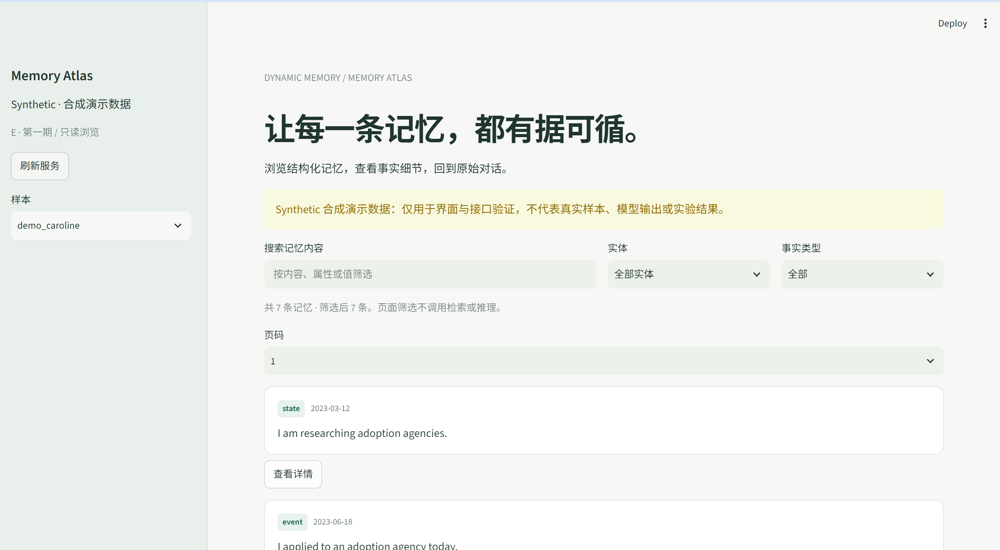

# E 第一期：记忆浏览与来源追溯

日期：2026-10-14。开发分支：E。状态：代码与测试完成，待按 README 流程独立审查和提交。

## 本批完成

从已有独立 Web 原型选择一个完整功能增量迁入：样本切换、记忆列表、内容/实体/类型筛选、四条一页分页、公共对象详情与原文追溯。保留绿色主题和启动脚本，迁入固定 synthetic 浏览数据。源原型保留，未一次性迁入问答和关系展示。

本批增加 WebBindings 只读服务接入、项目 AI skill、AGENTS 指引、接入说明和 30 项 Web 测试。CI 安装 web extra，CSS 配置为包资源，忽略 Streamlit secrets。README 更新已实现范围、启动方式及 E 分支状态。

### 页面展示

## 现阶段已实现的功能、实现方式与原理

Phase 1 完成 E 模块的只读记忆浏览闭环：选择样本 → 筛选记忆 → 查看详情 → 选择来源 → 查看原始对话。初始实现基于当时的技术规范 v2.1；本次集成按当前 `TECHNICAL_SPEC.md` v2.2 复核，公共业务 Schema 仍为 2.1，直接使用公共契约对象。

| 已实现功能 | 实现方式 | 原理 |
| --- | --- | --- |
| 样本选择与列表浏览 | `app.py` 的 `main()` 调用 `list_samples()`，通过侧栏选择样本，再调用 `list_memories(sample_id)`；`memory_card()` 展示内容、事实类型和事件时间 | 页面消费服务提供的既有记忆，保留列表顺序，不执行抽取、索引或状态推理 |
| 内容搜索与条件筛选 | `browse()` 对内容、属性和值拼接后的文本做 `casefold()` 和子串匹配；实体与事实类型使用下拉框精确匹配 | 在本次读取的列表上执行本地过滤，多项条件同时满足才保留；搜索忽略大小写，不调用语义检索 |
| 分页浏览 | 使用 `PAGE_SIZE = 4`，按筛选后的数量计算总页数，再通过列表切片取当前页 | 仅控制本页显示条数；当前实现每次页面重运行仍读取完整样本列表，不是服务端分页 |
| 记忆详情 | 点击按钮保存 `selected_memory`，通过 `get_memory(sample_id, memory_id)` 获取详情；以表格展示字段，并可展开完整 Schema 2.1 JSON | 通过稳定 ID 定位记录，避免以列表位置判断身份；详情读取结果必须与当前样本和记忆 ID 一致 |
| 原始对话追溯 | 从详情的 `source_refs` 生成来源按钮，将公共 `SourceRef` 传给 `get_turn(sample_id, ref)`，在原文查看器展示轮次、说话人、记录时间和原文 | 以 `(sample_id, session_id, dia_id)` 联合定位来源，并校验返回身份，防止显示其他样本或轮次的数据 |
| 图片描述与统一可见文本 | 使用 `st.text()` 展示未改写的原始 `text`；将 `image_caption` 与 `caption_origin` 单独标注；展开区调用公共 `render_visible_turn()` | 原始发言和机器图片描述分别展示，统一文本拼接规则由公共函数负责；页面不下载来源图片 |
| 未知时间展示 | 记忆卡片和详情读取 `event_time.raw`；原文查看器显示 `recorded_at`；字段为空时显示“未知”或“时间未知” | 保留服务提供的时间信息，不根据记录时间补推事件时间，也不据此判断记忆是否有效 |
| 服务接入与契约校验 | `bindings.py` 的 `ReadOnlyService` 描述四个只读方法，`WebBindings` 使用公共 Pydantic 模型校验返回值，并检查重复 ID 和身份匹配 | 将页面与实际服务实现分离；接入方提供已初始化服务，E 只负责调用与展示，不另建共享 DTO |
| 会话状态与刷新 | 用 `st.session_state` 保存绑定、样本、筛选、页码、记忆和来源；通过控件回调清除过期选择；“刷新服务”重新初始化当前会话绑定 | Streamlit 交互会重运行页面，状态按浏览器会话保存；切换上下文时主动失效，避免旧详情或来源混入新页面。服务绑定复用不等于列表或详情读取结果被缓存 |
| 来源失效处理 | 每次读取详情后检查已选来源是否仍在该记忆的 `source_refs` 中；来源读取失败时清除选择 | 后端来源变化后不再继续读取旧引用，保证查看器始终对应当前记忆 |
| 合成数据演示 | 未配置工厂时使用 `demo.py` 的固定数据和公共 `compute_memory_id()`，页面持续显示 Synthetic 提示；演示服务返回数据副本 | 无需 API 即可验证页面交互及公共对象传递；合成记录不代表真实样本或模型实验结果，数据副本避免调用方修改演示原始数据 |
| 空数据与异常提示 | 分别处理无样本、无记忆、筛选无匹配及服务异常；异常显示操作名称和诊断号，日志仅记录异常类型与诊断号 | 空结果与读取失败具有不同含义；配置真实服务后，失败保持可见，不自动切回演示，也不暴露原始异常中的敏感信息 |
| 页面样式与文本安全 | `assets/theme.css` 提供主题、卡片和窄屏样式，正文顶部预留固定栏空间；卡片中的动态内容先经 `html.escape()` 转义 | 静态 CSS 负责布局，原生 Streamlit 控件负责交互；动态文本不会作为卡片 HTML 标签执行 |

主要文件分工：`src/dynamic_memory/web/app.py` 负责页面与会话状态，`bindings.py` 负责只读服务接入与返回值校验，`demo.py` 提供固定合成数据，`assets/theme.css` 负责视觉布局。`streamlit_app.py` 是页面入口，`scripts/run_web.py` 提供启动命令。

当前已具备公共 DTO 服务注入能力，但尚未完成实际 A/B 服务的端到端接入验证。本期不包含问答提交、三路答案展示、关系判定或关系图；未实现或修改 A/B/C/D 的业务逻辑和共享契约。

## 验证记录

- E 独立虚拟环境运行全部测试：37 passed，其中 Web 30 项、已有合同测试 7 项。
- `python -m dynamic_memory.pipeline.mock_smoke`：PASS，不调用 API。
- 项目 skill 的 quick_validate：通过。
- `git diff --check`：通过。
- 实际启动 Streamlit，`/_stcore/health` 返回 `ok`。
- Headless Edge 验证桌面页面、记忆详情、来源按钮及 caption 显示；390px 视口检查无页面水平溢出。

测试覆盖正常浏览、空样本、空列表、未知时间、筛选/分页/样本切换重置、来源查看、真实 DTO 绑定、工厂失败、读取失败、身份不匹配、重复 ID、旧 Schema、HTML 转义及合成标签。浏览路径没有 run_query，也不执行抽取或索引。

这不是实际 A/B 服务端到端验收：当前只对公共 DTO 和合成服务完成验证。接入真实开发样本后仍需核对数据加载、来源与异常分支。列表一次读取全部记忆；若样本规模明显增长，应由团队先约定分页接口。

## 下一批建议

建议本批提交信息：`feat(web): add memory browsing and source inspection for E phase 1`。

本批具备独立运行和验收条件，可作为本次半周的功能增量。遵循 README 的独立审查要求，目前未执行 commit 或 push。不要回填时间或提前制造后续提交。

下一批在实际合同上迁入问答提交与三路结果状态展示，再单独接入 Dynamic 决策、关系及证据解释。每批以实际完成的功能和验证结果作为提交依据。

## 2026-10-18 补齐与复验

在 E 分支保留并复核已有 Phase 1 实现，未修改共享契约或其他成员模块。补齐原文记录时间展示，空时间显示“未知”；当服务返回的记忆来源列表变化时，清除已不属于当前记忆的来源选择，避免继续读取旧引用；原文读取失败时也清除失效选择。

新增来源变更及已知/未知记录时间的交互回归测试，并加强读取失败后的状态断言。本次使用 E 仓库 `.venv` 实际执行：

- `python -m pytest tests/web -q`：33 passed。
- `python -m pytest -q`：40 passed，包含 7 项共享合同测试。
- `python -m dynamic_memory.pipeline.mock_smoke`：PASS，无 API 调用。
- `git diff --check`：通过。
- 启动 `scripts/run_web.py --server.port=18519`，健康检查返回 `ok`，首页 HTTP 200，验证后关闭临时进程。

## 2026-10-18 顶部布局修复

截图中的英文标识被 Streamlit 固定顶部栏遮挡，原因是自定义样式将正文顶部留白压缩为 2rem。现将主内容顶部留白调整为 5rem，保留原生顶部栏及侧栏操作。

使用 Headless Edge 实测 1440px 桌面和 390px 手机视口：英文标识位于顶部栏下方，页面无水平溢出。截图位于 `docs/screenshots/phase1-header-1440.png` 和 `docs/screenshots/phase1-header-390.png`。Web 回归测试：33 passed。本次仅调整 E 页面样式，没有新增 Phase 2 功能。
